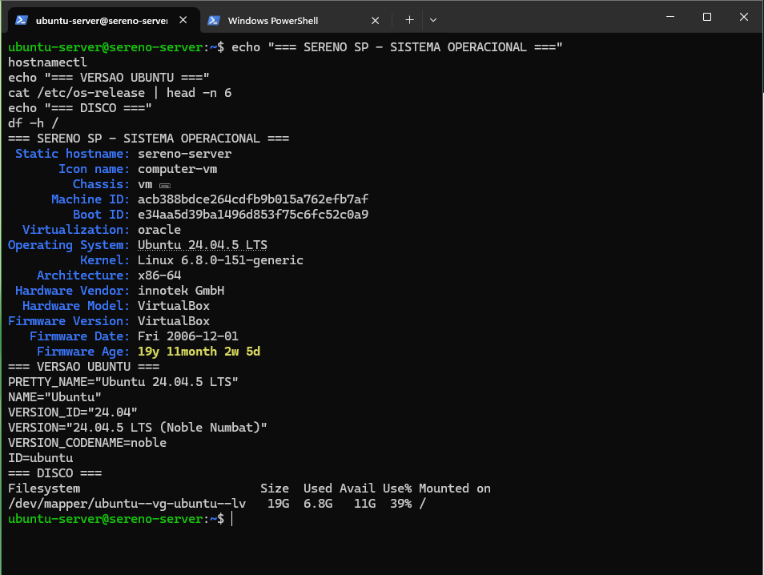
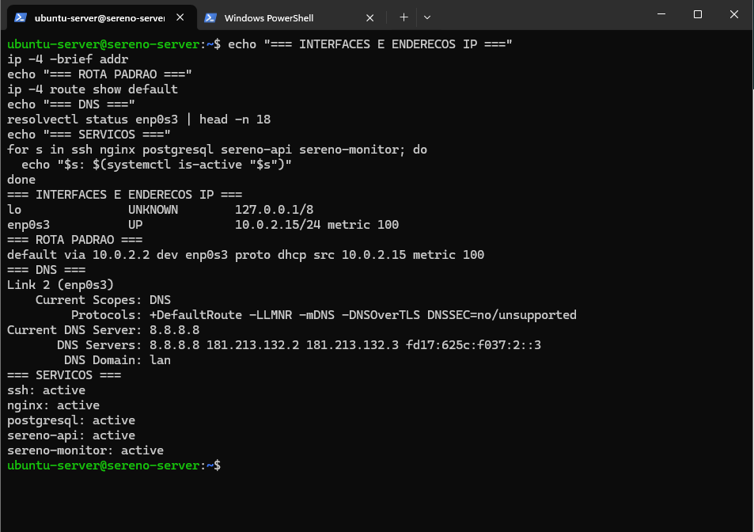
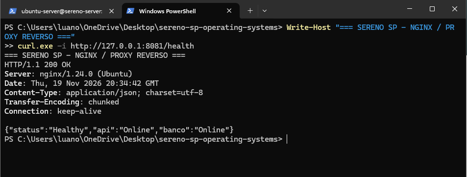
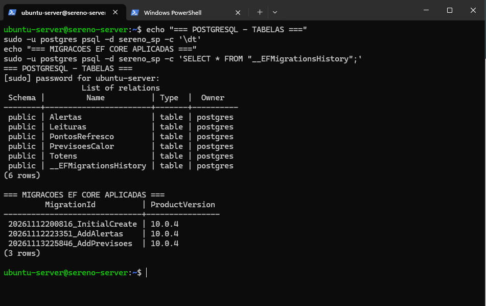
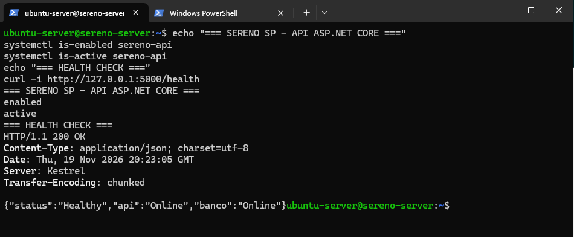
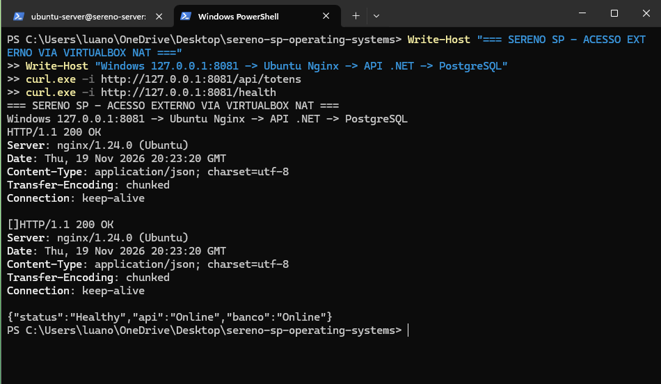
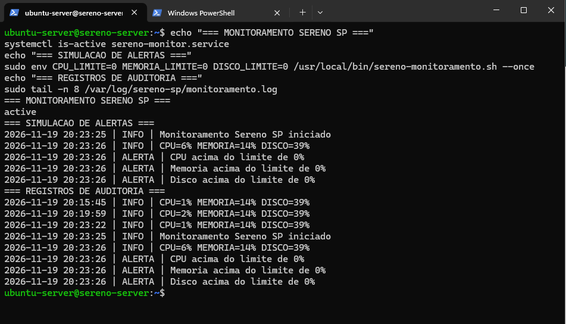
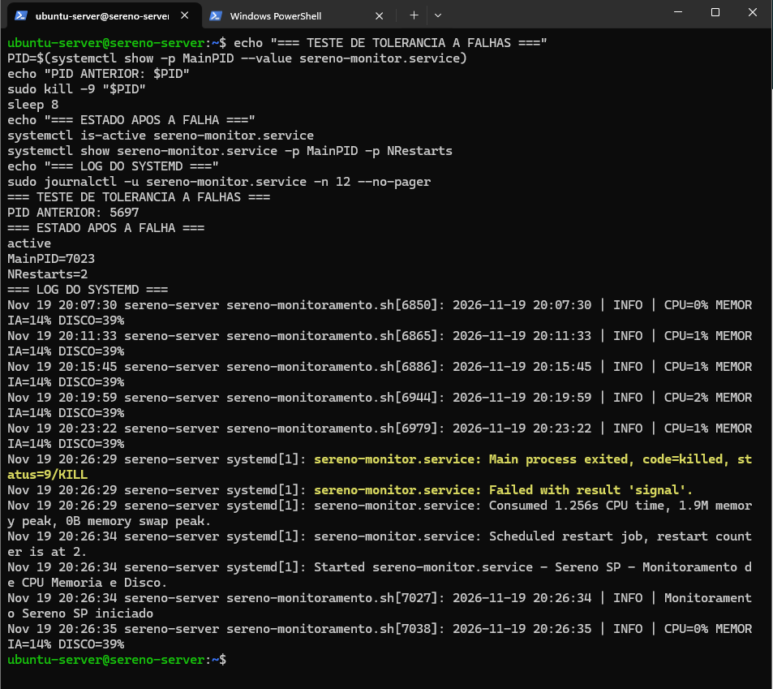
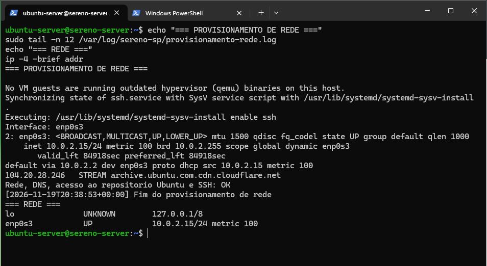
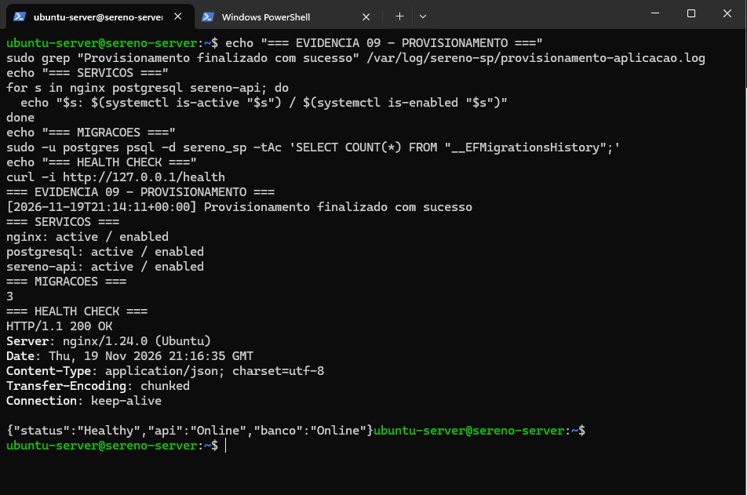

# Sereno SP — Operating Systems | Global Solution CitizenTech 2026

## Equipe

| Integrante | RM |
|---|---|
| Luan Orlandelli Ramos | 554747 |
| Arthur Bobadilla Franchi | 555056 |
| Jorge Luiz Silva Santos | 554418 |

## Problema urbano e solução CitizenTech

O calor urbano intenso aumenta a exposição de pessoas que circulam e trabalham ao ar livre, especialmente idosos e trabalhadores sujeitos a longos períodos ao sol. Informações meteorológicas gerais nem sempre representam as condições de cada localidade. O **Sereno SP** propõe uma plataforma para consolidar medições de sensores em totens, acompanhar previsões de calor e consultar pontos de refresco, apoiando decisões de prevenção e orientação à população.

Nesta disciplina, o foco é a **infraestrutura operacional e a continuidade do serviço**. O ambiente Linux hospeda a API Sereno SP com PostgreSQL, Nginx e serviços systemd, enquanto scripts Bash automatizam provisionamento, monitoramento, alertas e registro de auditoria.

## Arquitetura implantada

```text
Windows + navegador --> NAT VirtualBox (127.0.0.1:8081 -> VM:80)
                                      |
                                      v
                         Ubuntu Server 24.04.5 LTS
                           Nginx (porta 80)
                                      |
                                      v
                          ASP.NET Core 10 (5000)
                                      |
                                      v
                         PostgreSQL 16 (5432)

              systemd: sereno-api.service
              systemd: sereno-monitor.service
              Bash: CPU, memória, disco -> logs de auditoria
```

**Máquina usada nos testes:** VirtualBox `Sereno-SP-OS-Final`, Ubuntu Server 24.04.5 LTS, 2 vCPU, 4 GB RAM, novo VDI 40 GB, rede NAT com DHCP (`10.0.2.15`). Acesso SSH por `127.0.0.1:2223` (porta guest 22) e HTTP por `127.0.0.1:8081` (porta guest 80). Os endereços e portas do hospedeiro são específicos do laboratório.

## Estrutura do repositório

```text
scripts/
  01-provisionar-rede.sh
  02-provisionar-aplicacao.sh
  03-monitoramento.sh
  04-instalar-monitoramento.sh
systemd/
  sereno-api.service
  sereno-monitor.service
nginx/
  sereno-sp.conf
database/
  sereno-migrations.sql
prompts.md
evidencias/
README.md
```

## Procedimento de implantação

### 1. Pré-requisitos

- VirtualBox com VM Ubuntu Server 24.04 LTS; OpenSSH instalado.
- Rede NAT com as regras de redirecionamento acima.
- Publicação da API ASP.NET Core 10 para `linux-x64`, produzida a partir do projeto C# do Sereno SP. **O código da API está disponível no repositório [sereno-sp-csharp](https://github.com/LuanOrlandelli/sereno-sp-csharp)**; os binários compilados não integram este repositório de infraestrutura.
- Acesso à internet para instalar pacotes Ubuntu e .NET.

### 2. Preparar os arquivos no Ubuntu

No Windows, a partir da pasta que contém os projetos e o diretório `publish-linux`:

```powershell
scp -P 2223 -r .\publish-linux ubuntu-server@127.0.0.1:/home/ubuntu-server/
scp -P 2223 .\database\sereno-migrations.sql ubuntu-server@127.0.0.1:/home/ubuntu-server/
```

A partir da pasta local **deste repositório**:

```powershell
ssh -p 2223 ubuntu-server@127.0.0.1 "mkdir -p ~/sereno-os"
scp -P 2223 -r .\scripts .\systemd .\nginx .\database ubuntu-server@127.0.0.1:/home/ubuntu-server/sereno-os/
```

Os comandos criam previamente a pasta de destino. O arquivo `/etc/sereno-sp/sereno.env` contém as credenciais e **não deve ser copiado para o repositório**.

### 3. Rede, aplicação e banco

```bash
cd ~/sereno-os
sudo bash scripts/01-provisionar-rede.sh
sudo bash scripts/02-provisionar-aplicacao.sh
```

O script de aplicação instala Nginx, PostgreSQL 16 (Ubuntu 24.04) e runtime ASP.NET Core 10, cria `sereno_app` e `sereno_sp` caso não existam, executa o script SQL de migrações EF Core, prepara a pasta `/opt/sereno-sp` e registra o serviço `sereno-api.service`. Uma senha de banco é solicitada apenas se não houver configuração pré-existente. O arquivo `/etc/sereno-sp/sereno.env` deve permanecer protegido e nunca ser enviado ao GitHub. Em ambiente já provisionado, preserve as credenciais existentes.

Conferir:

```bash
systemctl is-enabled sereno-api
systemctl is-active sereno-api nginx postgresql
curl -i http://127.0.0.1:5000/health
curl -i http://127.0.0.1/health
sudo -u postgres psql -d sereno_sp -c '\dt'
```

### 4. Instalar monitoramento e gerar alertas

```bash
cd ~/sereno-os
sudo bash scripts/04-instalar-monitoramento.sh
systemctl is-active sereno-monitor.service
sudo tail -n 10 /var/log/sereno-sp/monitoramento.log
```

O monitor verifica CPU, memória e disco a cada 30 segundos. Limites padrão: CPU 80%, RAM 85%, disco 90%. Os alertas são escritos em `/var/log/sereno-sp/monitoramento.log` juntamente com métricas e horário.

Simular **sem sobrecarregar a VM**, executando uma verificação única com limiares zero:

```bash
sudo env CPU_LIMITE=0 MEMORIA_LIMITE=0 DISCO_LIMITE=0 bash scripts/03-monitoramento.sh --once
sudo tail -n 8 /var/log/sereno-sp/monitoramento.log
```

### 5. Testar tolerância a falhas

```bash
PID=$(systemctl show -p MainPID --value sereno-monitor.service)
echo "PID anterior: $PID"
sudo kill -9 "$PID"
sleep 8
systemctl is-active sereno-monitor.service
systemctl show sereno-monitor.service -p MainPID -p NRestarts
```

O systemd mantém o serviço habilitado para iniciar no boot e o reinicia após encerramento inesperado (`Restart=always`, `RestartSec=5`). No teste documentado na evidência 07b, o processo passou do PID `5697` para `7023`, com `NRestarts=2` e logs do systemd confirmando o reinício após `SIGKILL`.

### 6. Logs e auditoria

```bash
sudo tail -n 30 /var/log/sereno-sp/monitoramento.log
sudo tail -n 30 /var/log/sereno-sp/provisionamento-rede.log
sudo tail -n 30 /var/log/sereno-sp/provisionamento-aplicacao.log
sudo journalctl -u sereno-monitor.service -n 20 --no-pager
sudo journalctl -u sereno-api.service -n 20 --no-pager
```

As imagens abaixo registram a implantação e os testes realizados na VM `Sereno-SP-OS-Final`, incluindo a execução dos dois scripts de provisionamento, o monitoramento, os alertas, a recuperação automática e a verificação HTTP da API.

## Evidências

### Ubuntu Server instalado


### Infraestrutura Linux, rede e serviços ativos


### Acesso web do Windows ao Nginx


### PostgreSQL com tabelas e migrações


### API ASP.NET Core respondendo HTTP 200


### API acessada do Windows, banco online


### 07 — Monitoramento e alertas de CPU, memória e disco
A execução com limites de teste zerados (`CPU_LIMITE=0`, `MEMORIA_LIMITE=0` e `DISCO_LIMITE=0`) gerou os três alertas sem induzir sobrecarga real no servidor.



### 07b — Tolerância a falhas e reinicialização automática
Após o encerramento intencional do processo do monitor (`SIGKILL`), o systemd iniciou um novo processo e registrou a recuperação do serviço.



### 08 — Provisionamento da rede
Execução do script `01-provisionar-rede.sh` com verificação de interface, IP, rota padrão, DNS, SSH e registro de auditoria.



### 09 — Provisionamento da aplicação
Execução do script `02-provisionar-aplicacao.sh`, verificação dos serviços habilitados e ativos, das três migrações EF Core e do health check HTTP 200 com banco online.



## Demonstração em vídeo

A demonstração em vídeo, com duração máxima de **7 minutos**, apresenta a VM, o acesso por SSH, os scripts de provisionamento, o `/health`, o banco com as migrações, os logs de monitoramento, a simulação dos três alertas e a reinicialização automática do serviço. O vídeo deve ser disponibilizado na entrega conforme as instruções da disciplina.

## Critérios técnicos apresentados

| Critério | Implementação |
|---|---|
| Provisionamento de rede | Bash, hostname, rede DHCP/NAT, gateway, DNS e SSH |
| Provisionamento da aplicação | Bash, PostgreSQL, ASP.NET Core, Nginx, migrações, systemd |
| Monitoramento e alertas | CPU, memória e disco com limiares configuráveis |
| Tolerância a falhas | `sereno-monitor.service`, `Restart=always` |
| Auditoria | Logs de provisionamento, monitoramento e journal do systemd |
| Execução integrada | API e banco online com Nginx e acesso do Windows |
